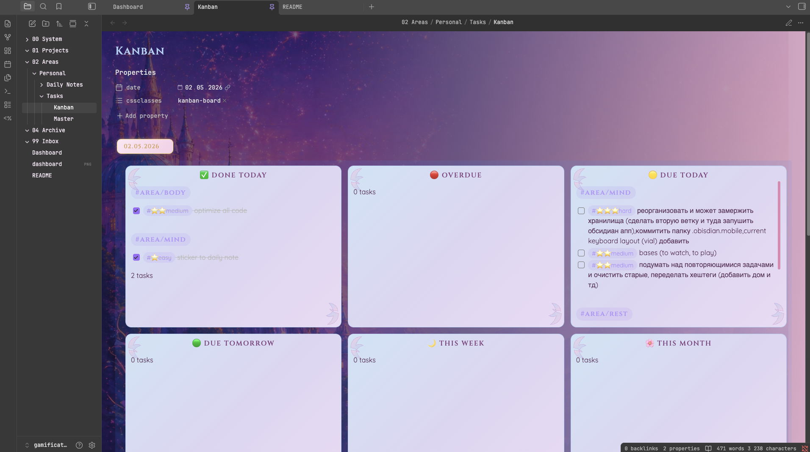

# ✨ Winx Vault — Obsidian RPG Dashboard

A gamified personal productivity system built in Obsidian with a magical-girl aesthetic. Track tasks, habits, energy, and life balance through an RPG-style dashboard.


---

## 🗂 Vault Structure

```
├── 📁 00 System
│   ├── 📁 Assets - Sounds for pomodoro and shop
│   ├── 📁 Data
│   │   ├── Shop.md
│   │   └── Celestial Market.md
│   ├── 📁 Scripts
│   │   ├── 📁 QuickAdd
│   │   │   ├── NewTask.js           — Task creation macro (difficulty + area pickers)
│   │   │   └── NewMarketItem.js     — Add an item to the Celestial Market
│   │   └── 📁 dvWidgets
│   │       ├── config.js              — Central config (areas, difficulties, XP values, levels)
│   │       ├── levelToday.js          — Level & XP progress card
│   │       ├── xpToday.js             — XP earned today + streak heatmap
│   │       ├── habits.js              — Monthly habits bar chart (not on the dashboard)
│   │       ├── lifeAreas.js           — Radar chart of life area scores
│   │       ├── weeklyState.js         — Energy & mood line chart (not on the dashboard)
│   │       ├── helpers.js             — Shared AudioEngine, Wallet, PurchaseLog
│   │       ├── wallet.js              — Gold balance widget (not on the dashboard)
│   │       ├── shop.js                — Shop view with buy buttons
│   │       ├── pomodoro.js            — Pomodoro timer
│   │       ├── goalsLib.js            — Pure week / goal / cycle logic (tested in tests/)
│   │       ├── goals.js               — Goals: "X из Y на этой неделе" + Mon–Sun dots
│   │       ├── cycle.js               — Cycle day and next start forecast
│   │       ├── week.js                — Weekly review (used by Week.md)
│   │       ├── celestialMarket.js     — Celestial Market shopping list widget
│   │       └── dailyNote.js           — Date selector widget
│   └── 📁 Templates
│       ├── Daily Note.md — Templater template for new daily notes
│       ├── game.md — Templater template for new game
│       ├── recipe.md — Templater template for new recipe
│       ├── task.md — Templater template for new task
│       ├── read item.md — Templater template for new read item (book, article, etc)
│       └── watch item.md — Templater template for new watch item (cartoon, movie, etc)
├── 📁 01 Projects
├── 📁 02 Areas
│   ├── 📁 Health & Body
│   │   └── Cycle.md — Cycle start dates (`period::`, `- start::`)
│   └── 📁 Personal
│       ├── Goals.md — Goal list (see Goals)
│       ├── 📁 Daily Notes — Daily journal entries (notes, XP log)
│       └── 📁 Tasks
│           └── Kanban.md — Kanban board view of tasks
├── 📁 03 Resources
│   ├── 📁 Collections — Card-view lists (Obsidian Bases) with example entries
│   │   ├── 📁 Readlist — Books & fanfics to read
│   │   ├── 📁 Gamelist — Games to play
│   │   ├── 📁 Watchlist — Movies, series & cartoons
│   │   └── 📁 Recipes — Recipe cards
│   └── 📁 Media — Attachments (images, fonts)
├── 📁 04 Archive
├── 📁 99 Inbox
├── Dashboard.md
├── Week.md — Weekly review page
└── 📁 tests — `node --test tests/*.test.mjs`
```

---

## ⚙️ Required Plugins

> Obsidian version: 1.12.7

| Plugin | Version | Purpose |
|---|---|---|
| **Dataview** | 0.5.68 | Powers all JS widgets |
| **Templater** | 2.19.3 | Daily note template |
| **Tasks** | 7.23.1 | Task tracking & completion dates |
| **QuickAdd** | 2.12.0 | `NewTask` macro for fast task creation |
| **Charts** | 3.9.0 | Radar, bar & line charts in widgets |
| **Meta Bind** | 1.4.8 | `INPUT[slider]` and `INPUT[date]` inline inputs |

---

## 🎮 XP & Leveling System

Tasks are tagged with a **difficulty** and a **life area**. Completing a task awards XP.

### Difficulties

| Tag | XP | Gold |
|---|---|---|
| `#⭐easy` | 5 | 2 |
| `#⭐⭐medium` | 10 | 5 |
| `#⭐⭐⭐hard` | 20 | 10 |
| `#⭐⭐⭐⭐epic` | 50 | 25 |

### Level Formula

Level `n` costs `100 + (n-1) × 25` XP. Levels are named:

| Name | Total XP threshold |
|---|---|
| VOID | 0 |
| SPARK | 10 |
| GLOW | 20 |
| AURA | 30 |
| TRANSFORMATION | ∞ |

### Habit Bonus

Complete a habit **30+ times** in a month → **+100 XP** bonus per qualifying habit.

---

## 🌐 Life Areas (Radar Chart)

| Emoji | Tag | Radar Name |
|---|---|---|
| 🏃 Body | `#area/body` | Vitality |
| 💼 Work | `#area/work` | Craft |
| 🧠 Mind | `#area/mind` | Knowledge |
| 💰 Wealth | `#area/wealth` | Resources |
| 🏡 Base | `#area/base` | Sanctuary |
| 🌄 Occasions | `#area/occasions` | Memory |
| 🌙 Rest | `#area/rest` | Serenity |

---

## 🛍 Shop

Completing tasks earns **gold** alongside XP. Spend it on real-world rewards defined in `Shop.md`.

### How it works

1. **Earn** — completing any tagged task adds gold (see Difficulties table).
2. **Browse** — open `Shop.md` to see your balance and available items. Affordable items show ✅, unaffordable show ❌.
3. **Buy** — click an affordable item. The purchase is logged to `Purchases.md` and the balance updates immediately.

### Adding items

Edit `Shop.md` and add a list entry:

- name:: Cozy Coffee cost:: 20

### Caching

Earned and spent totals are computed once and cached in memory. The cache is invalidated automatically when task or purchase files change, so widget re-renders are fast.

---

## 🌌 Celestial Market

A themed shopping list, rendered as a dashboard card. Items live in `00 System/Data/Celestial Market.md` as regular checkbox tasks tagged with a category; the widget groups pending items by category and shows how many are left. Checking an item off in the file clears it from the card.

### Categories

| Group | Tag |
|---|---|
| 🌿 Harvest | `#food` |
| 🌸 Bloom | `#care` |
| 🐾 Familiar | `#pet` |
| 🏰 Sanctuary | `#home` |
| ✨ Vitality | `#health` |

Untagged items land in a ✦ Other group.

### Adding items

Use the **QuickAdd `New Market Item` macro** (pick a category, type the name), or edit `Celestial Market.md` directly:

- \[ \] Fresh bread #food

---

## 🎯 Goals

A goal is a regular **recurring task** in `Tasks/Master.md` tagged `#goal/<slug>`, ticked off in the Kanban like any task (and earning XP). `02 Areas/Personal/Goals.md` describes each goal:

```
- name:: Растяжка
  tag:: #goal/stretch
  days:: вт, чт, сб
  min:: 5 минут на коврике
  plan:: если выключила компьютер вечером, раскатываю коврик
```

- `days` (пн … вс) sets the weekly plan; otherwise `perWeek:: N`. If both are given, `days` wins.
- A day counts as done when a completed task with the tag has `✅` on that day. Weeks start on Monday.
- Use repeats without `when done`. A missed goal task is moved by the Goals widget to the next planned day (not before today), so it never piles up in Overdue; Kanban's Overdue skips `#goal` tasks anyway.
- **Week.md** shows the selected week: goals × days, cycle day, other tasks done and still open, and the first lines of each daily note.

---

## 📝 Daily Note

Each daily note has:
- **Notes** — free text (first lines show up on the Week page)
- **XP Log** — freeform notes on what you did/learned

Create via Templater from `00 System/Templates/Daily Note.md` (the Daily Notes core plugin is preconfigured to use it), or just click **✦ Open** on the dashboard — if the selected day has no note yet, it's created from the template automatically.

---

## ✅ Creating a Task



Use the **QuickAdd `NewTask` macro**:
1. Choose difficulty (Easy / Medium / Hard / Epic)
2. Choose life area
3. Fill in task details in the Tasks modal
4. Task is prepended to `Tasks/Master.md`

### Other QuickAdd choices

| Choice | Template | Creates note in |
|---|---|---|
| **Work task** | `task.md` | `01 Projects` |
| **Read item** | `read item.md` | `03 Resources/Collections/Readlist` |
| **Watch item** | `watch item.md` | `03 Resources/Collections/Watchlist` |
| **Game** | `game.md` | `03 Resources/Collections/Gamelist` |
| **Recipe** | `recipe.md` | `03 Resources/Collections/Recipes` |

> ⚠️ **Work task** targets the generic `01 Projects` folder. Point it at your own project folder instead (Settings → QuickAdd → Work task → folder). If you sync this vault's QuickAdd config into another vault, remember the sync overwrites that folder setting — re-pick your project folder afterwards.

---

## 🖥 Dashboard Widgets

| Widget | Description |
|---|---|
| **Level** | Current level, total XP, progress to next level |
| **Pomodoro** | 25/5 min focus timer, session counter |
| **Goals** | Per goal "X из Y на этой неделе", Mon–Sun dots, minimum version |
| **Life Areas** | Radar chart — XP earned per area this month |
| **Cycle** | Cycle day, next start forecast, "началось сегодня" button |
| **XP Today** | XP earned today, current level name, streak heatmap |
| **Quests** | Tasks due today, grouped by life area tag |
| **Celestial Market** | Pending shopping items grouped by category |
| **Shop**   | (in Shop.md) Browse rewards, click to buy with gold |
