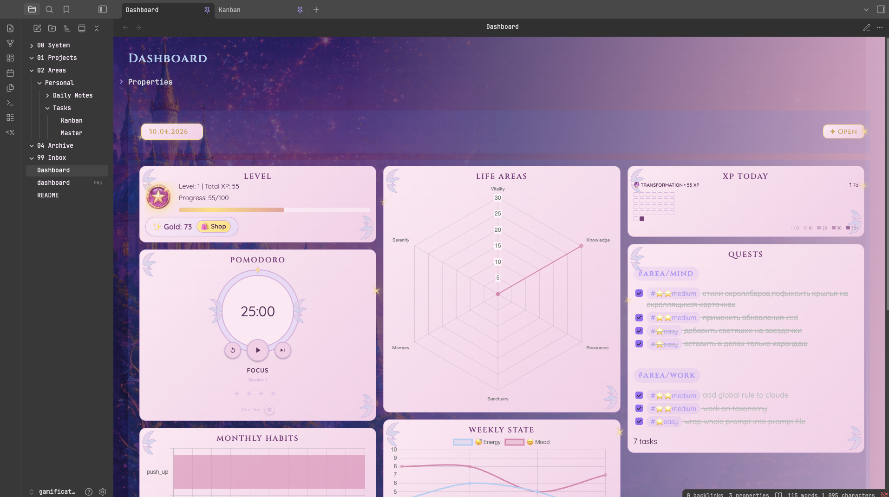

# ✨ Winx Vault — Obsidian RPG Dashboard

A gamified personal productivity system built in Obsidian with a magical-girl aesthetic. Track tasks, habits, energy, and life balance through an RPG-style dashboard.



---

## 🗂 Vault Structure

```
├── 📁 plugin — the Winx plugin: widgets, task window, commands, styles (see Development)
│   ├── 📁 src
│   │   ├── main.ts               — loads everything; window.winx.render for the notes' blocks
│   │   ├── commands.ts           — Cmd+P commands: New task, New watch/read item, New game, Buy reward, New market item
│   │   ├── 📁 ui
│   │   │   └── form.ts           — one window of buttons / text boxes instead of a chain of prompts
│   │   ├── 📁 lib
│   │   │   ├── config.js         — areas, difficulties, XP values, levels, market categories
│   │   │   ├── goalsLib.js       — pure week / goal / cycle / weight logic (tested)
│   │   │   ├── task.js           — one task line in the Tasks format: read it, change it (tested)
│   │   │   ├── items.js          — watch / read / game notes (tested)
│   │   │   └── helpers.js        — dates, task line edits, task window, wallet, purchases, market, sounds
│   │   └── 📁 widgets            — one file per widget, render(dv, input)
│   │       ├── calendar.js       — week / month calendar, No date / Regulars / Pool tabs, drag and drop
│   │       ├── yesterday.js      — "Missed?" box inside the calendar
│   │       ├── levelToday.js, xpToday.js, goals.js, lifeAreas.js, cycle.js, weight.js, pomodoro.js,
│   │       ├── celestialMarket.js, shop.js, supplies.js, wallet.js, habits.js, weeklyState.js,
│   │       └── week.js, dailyNote.js, finance.js, mobileHome.js, mobileShopping.js
│   ├── 📁 styles                 — Sass partials, built into the plugin's styles.css
│   └── 📁 tests                  — npm test; tests/obsidian/ checks styles inside Obsidian
├── 📁 00 System
│   ├── 📁 Assets — sounds for pomodoro and shop, task stickers (stickers/)
│   ├── 📁 Data
│   │   ├── Shop.md
│   │   └── Celestial Market.md
│   ├── 📁 Scripts
│   │   ├── notify.js — desktop reminders (Templater startup script)
│   │   └── 📁 QuickAdd
│   │       └── MirrorMobileConfig.js — copies obsidian-mobile/ into the phone's config folder
│   └── 📁 Templates
│       ├── Daily Note.md — Templater template for new daily notes
│       ├── recipe.md — Templater template for new recipe
│       └── task.md — Templater template for new work task
├── 📁 01 Projects
├── 📁 02 Areas
│   ├── 📁 Health & Body
│   │   └── Cycle.md — Cycle start dates (`period::`, `- start::`)
│   └── 📁 Personal
│       ├── Goals.md — Goal list (see Goals)
│       ├── 📁 Daily Notes — Daily journal entries (notes, XP log)
│       └── 📁 Tasks
│           ├── Master.md — all tasks
│           ├── Calendar.md — the calendar
│           └── Kanban.md — Kanban board view of tasks
├── 📁 03 Resources
│   ├── 📁 Collections — Card-view lists (Obsidian Bases) with example entries
│   │   ├── 📁 Readlist — Books & fanfics to read
│   │   ├── 📁 Gamelist — Games to play
│   │   ├── 📁 Watchlist — Movies, series & cartoons
│   │   └── 📁 Recipes — Recipe cards
│   └── 📁 Media — Attachments (images, fonts)
├── 📁 04 Archive
├── 📁 99 Inbox
├── Dashboard.md
└── Week.md — Weekly review page
```

A note shows a widget with a Dataview block:

````
```dataviewjs
await winx.render("weight", dv);
```
````

---

## ⚙️ Required Plugins

> Build the Winx plugin first: `cd plugin && npm ci && WINX_VAULT=.. npm run dev` (or `npm run build` and copy `plugin/dist/*` into `.obsidian/plugins/winx/`). Without it every card shows "winx is not defined".

> Obsidian version: 1.12.7

| Plugin | Version | Purpose |
|---|---|---|
| **Winx** | (this repo, `plugin/`) | Widgets, task window, commands, all styles |
| **Dataview** | 0.5.68 | Data for the widgets (their `dataviewjs` blocks) |
| **Templater** | 2.19.3 | Daily note template |
| **Tasks** | 7.23.1 | Task tracking & completion dates |
| **QuickAdd** | 2.12.0 | Work task and Recipe notes; Update Mobile Config on the phone |
| **Charts** | 3.9.0 | Radar, bar & line charts in widgets |
| **Meta Bind** | 1.4.8 | `INPUT[slider]` and `INPUT[date]` inline inputs |

---

## 🎮 XP & Leveling System

Tasks are tagged with a **difficulty** and a **life area**. Completing a task awards XP.

### Difficulties

| Tag | XP | Gold |
|---|---|---|
| `#⭐easy` | 5 | 2 |
| `#⭐⭐medium` | 10 | 5 |
| `#⭐⭐⭐hard` | 20 | 10 |
| `#⭐⭐⭐⭐epic` | 50 | 25 |

### Level Formula

Level `n` costs `100 + (n-1) × 25` XP. Levels are named:

| Name | Total XP threshold |
|---|---|
| VOID | 0 |
| SPARK | 10 |
| GLOW | 20 |
| AURA | 30 |
| TRANSFORMATION | ∞ |

### Habit Bonus

Complete a habit **30+ times** in a month → **+100 XP** bonus per qualifying habit.

---

## 🌐 Life Areas (Radar Chart)

| Emoji | Tag | Radar Name |
|---|---|---|
| 🏃 Body | `#area/body` | Vitality |
| 💼 Work | `#area/work` | Craft |
| 🧠 Mind | `#area/mind` | Knowledge |
| 💰 Wealth | `#area/wealth` | Resources |
| 🏡 Base | `#area/base` | Sanctuary |
| 🌄 Occasions | `#area/occasions` | Memory |
| 🌙 Rest | `#area/rest` | Serenity |

---

## 🛍 Shop

Completing tasks earns **gold** alongside XP. Spend it on real-world rewards defined in `Shop.md`.

### How it works

1. **Earn** — completing any tagged task adds gold (see Difficulties table).
2. **Browse** — open `Shop.md` to see your balance and available items. Affordable items show ✅, unaffordable show ❌.
3. **Buy** — click an affordable item. The purchase is logged to `Purchases.md` and the balance updates immediately.

### Adding items

Edit `Shop.md` and add a list entry:

- name:: Cozy Coffee cost:: 20

### Caching

Earned and spent totals are computed once and cached in memory. The cache is invalidated automatically when task or purchase files change, so widget re-renders are fast.

---

## 🌌 Celestial Market

A themed shopping list, rendered as a dashboard card. Items live in `00 System/Data/Celestial Market.md` as regular checkbox tasks tagged with a category; the widget groups pending items by category and shows how many are left. Checking an item off in the file clears it from the card.

### Categories

| Group | Tag |
|---|---|
| 🌿 Harvest | `#food` |
| 🌸 Bloom | `#care` |
| 🐾 Familiar | `#pet` |
| 🏰 Sanctuary | `#home` |
| ✨ Vitality | `#health` |

Untagged items land in a ✦ Other group.

### Adding items

Use **Winx: New market item** in Cmd+P (pick a category, type the name), or edit `Celestial Market.md` directly:

- \[ \] Fresh bread #food

---

## 🎯 Goals

A goal is a regular **recurring task** in `Tasks/Master.md` tagged `#goal/<slug>`, ticked off in the Kanban like any task (and earning XP). `02 Areas/Personal/Goals.md` describes each goal:

```
- name:: Растяжка
  tag:: #goal/stretch
  days:: вт, чт, сб
  min:: 5 минут на коврике
  plan:: если выключила компьютер вечером, раскатываю коврик
```

- `days` (пн … вс) sets the weekly plan; otherwise `perWeek:: N`. If both are given, `days` wins.
- A day counts as done when a completed task with the tag has `✅` on that day. Weeks start on Monday.
- Use repeats without `when done`. A missed goal task is moved by the Goals widget to the next planned day (not before today), so it never piles up in Overdue; Kanban's Overdue skips `#goal` tasks anyway.
- **Week.md** shows the selected week: goals × days, cycle day, other tasks done and still open, and the first lines of each daily note.

---

## 📝 Daily Note

Each daily note has:
- **Notes** — free text (first lines show up on the Week page)
- **XP Log** — freeform notes on what you did/learned

Create via Templater from `00 System/Templates/Daily Note.md` (the Daily Notes core plugin is preconfigured to use it), or just click **✦ Open** on the dashboard — if the selected day has no note yet, it's created from the template automatically.

---

## ✅ Creating a Task

Use **Winx: New task** in Cmd+P:
1. One window: difficulty and area (both needed), time of day, sticker; or tick **To pool** to keep it in `Pool.md` (the calendar's Pool tab) instead
2. Fill in the text and dates in the Tasks modal
3. The task goes to the top of `Tasks/Master.md` (a pool item to the end of `Tasks/Pool.md`)

The ✏️ on a calendar task opens the same window, then the Tasks modal.

### Other commands

| Command (Cmd+P) | Creates |
|---|---|
| **Winx: New watch item** / **New read item** / **New game** | a note in `03 Resources/Collections/Watchlist` / `Readlist` / `Gamelist` |
| **Winx: Buy reward** | a line in `00 System/Data/Purchases.md` |
| **Winx: New market item** | an item in `00 System/Data/Celestial Market.md` |

QuickAdd keeps two Templater choices:

| Choice | Template | Creates note in |
|---|---|---|
| **Work task** | `task.md` | `01 Projects` |
| **Recipe** | `recipe.md` | `03 Resources/Collections/Recipes` |

> ⚠️ **Work task** targets the generic `01 Projects` folder. Point it at your own project folder instead (Settings → QuickAdd → Work task → folder). If you sync this vault's QuickAdd config into another vault, remember the sync overwrites that folder setting — re-pick your project folder afterwards.

---

## 🖥 Dashboard Widgets

| Widget | Description |
|---|---|
| **Level** | Current level, total XP, progress to next level |
| **Pomodoro** | 25/5 min focus timer, session counter |
| **Goals** | Per goal "X из Y на этой неделе", Mon–Sun dots, minimum version |
| **Life Areas** | Radar chart — XP earned per area this month |
| **Cycle** | Cycle day, next start forecast, "началось сегодня" button |
| **XP Today** | XP earned today, current level name, streak heatmap |
| **Quests** | Tasks due today, grouped by life area tag |
| **Celestial Market** | Pending shopping items grouped by category |
| **Shop**   | (in Shop.md) Browse rewards, click to buy with gold |

---

## 🛠 Development

The plugin is built with esbuild (TypeScript, JS modules) and Sass. Node 24:

```sh
cd plugin
npm ci
npm test                                   # unit tests
WINX_VAULT=/path/to/your/vault npm run dev # build into <vault>/.obsidian/plugins/winx on every save
```

Then enable **Winx** in Settings → Community plugins. After a rebuild run **Winx: Reload** (Cmd+P) instead of restarting Obsidian, and reopen the open notes: widgets already drawn keep the old code. `npm run build` makes `plugin/dist/` (`main.js`, `styles.css`, `manifest.json`).

`tests/obsidian/styles-snapshot.js` records the computed styles of every element on a set of pages (run it inside Obsidian); `compare-snapshots.mjs` diffs two such records, to check that a style change moved nothing it shouldn't.

## 📱 Phone

The plugin works on the phone (no desktop-only APIs). A vault that syncs from this repo builds the plugin in its sync job and ships it with the other plugins.

