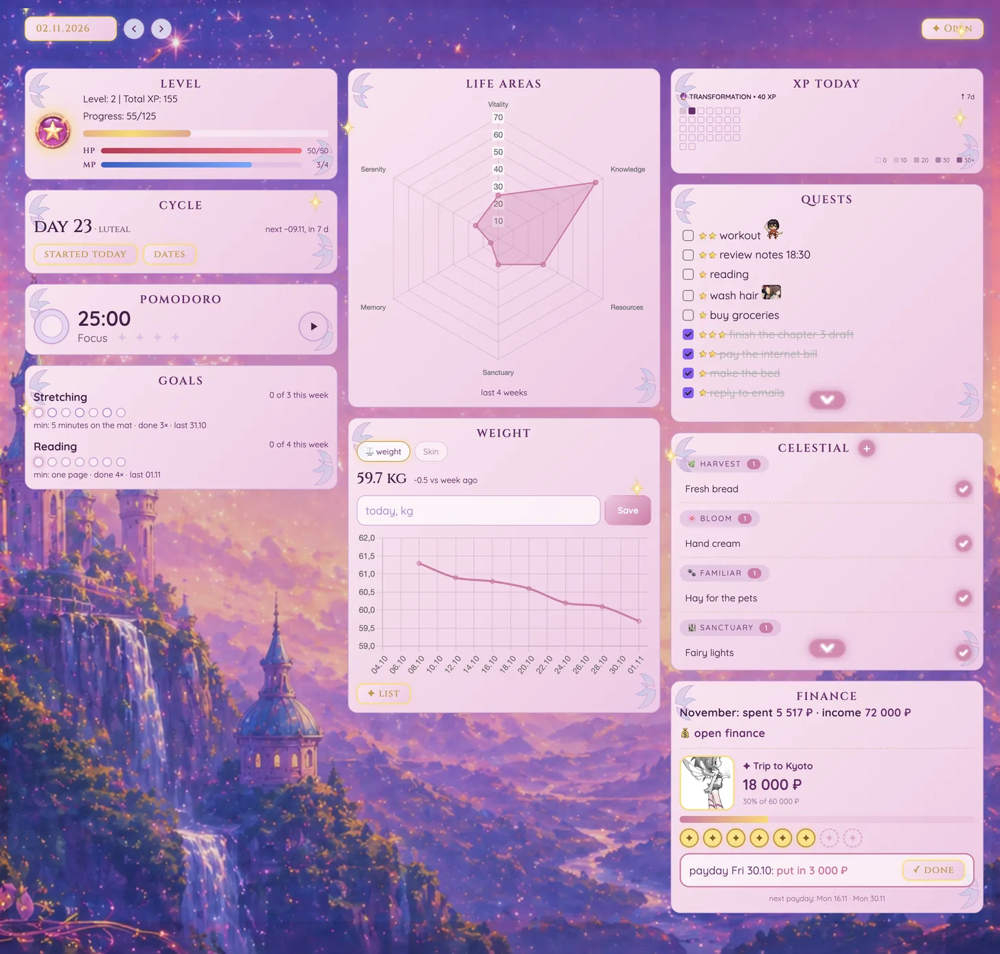
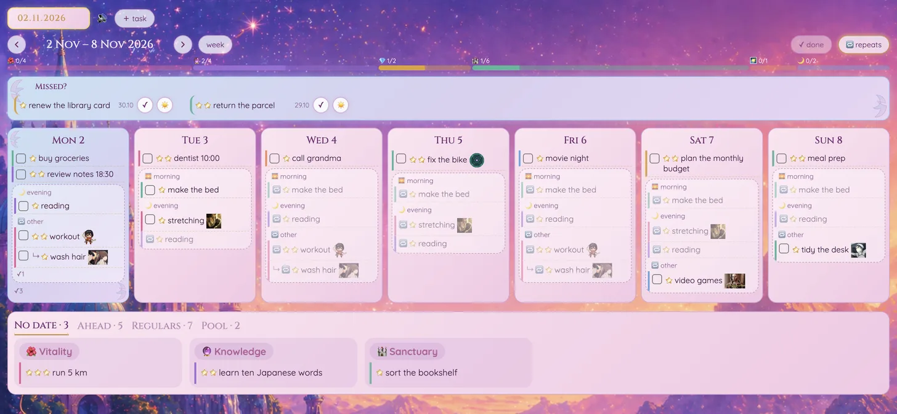
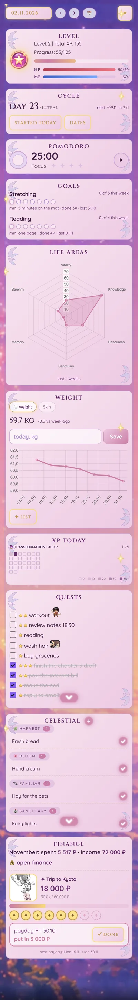
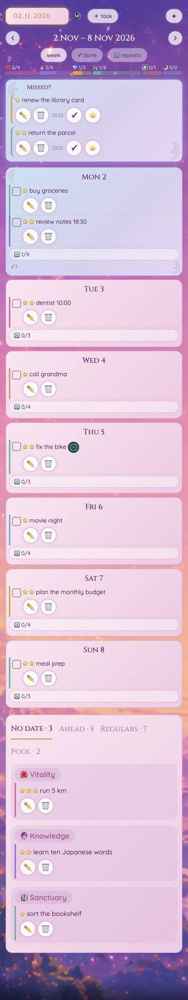

# ✨ Winx Vault — Obsidian RPG Dashboard

A gamified personal productivity system built in Obsidian with a magical-girl aesthetic. Track tasks, habits, goals and life balance through an RPG-style dashboard and a task calendar.

 

The repo is two things at once:

- **an example vault** (open the repo folder in Obsidian) with demo notes, tasks and the dashboard;
- **the Winx plugin** (`plugin/`): every widget, the calendar tab, the task window, the commands and all the styles. Notes only say where a widget goes.

**Quick start:** build the plugin (`cd plugin && npm ci && npm run build`, then copy `plugin/dist/*` into `.obsidian/plugins/winx/`), open the folder as a vault, turn on community plugins, click ✨ on the left. Details in [Installation](docs/installation.md).

## Upgrading from the old task format

For a vault whose `Master.md` has `#area/…` tags and 📅 / 🔁 dates in the text (and maybe a `Pool.md`):

1. **Before you migrate: make a full backup of the vault** — a copy of the folder, or a git commit / branch of it. Don't skip this. At the very least keep `00 System/Data/Tasks/` and `.obsidian/plugins/obsidian-tasks-plugin/data.json`; the whole vault is best.
2. Update the plugin (build, copy `plugin/dist/*`) and reload.
3. Turn the sync plugin off, or let it finish, so the phone can't send the old files back mid-way. Then run **Winx: Migrate tasks** from the command palette. It gives every task an id (`t12`; a task and its done copies the same one), writes `00 System/Data/Tasks/tasks.json` (name, difficulty, area, time, goal, sticker… by id), rewrites `Master.md` as id + Tasks' Dataview fields, moves `Pool.md` to the trash (its tasks become records with `pool: true`) and keeps `Master (old).md` and `Pool (old).md`. It refuses to run when `tasks.json` or either `(old)` copy exists.
4. Settings → Tasks → Task format → **Dataview**, on every device (each one keeps its own Tasks settings, the phone too). A device left on the emoji format writes `✅` when a task is ticked there and makes no next copy of a 🔁 task.
5. Reload and check the calendar.
6. With a sync plugin: sync the desktop first, then the phone before editing there.

To go back: restore `Master (old).md` as `Master.md` (and `Pool (old).md` as `Pool.md`), delete `tasks.json`, switch Tasks' format back to the emoji one, and use the previous plugin build.

## Docs

- [Installation](docs/installation.md) — install, your own vault, keeping it in sync, the phone
- [Tasks and the calendar](docs/tasks-and-calendar.md) — tasks (an id per task, Winx's fields in `tasks.json`), commands, the calendar tab, medication courses (vitamins and medicines: what to take when, ticked day by day)
- [Dashboard](docs/dashboard.md) — the cards, XP, shop, market, goals, daily note
- [Development](docs/development.md) — structure, build, tests
