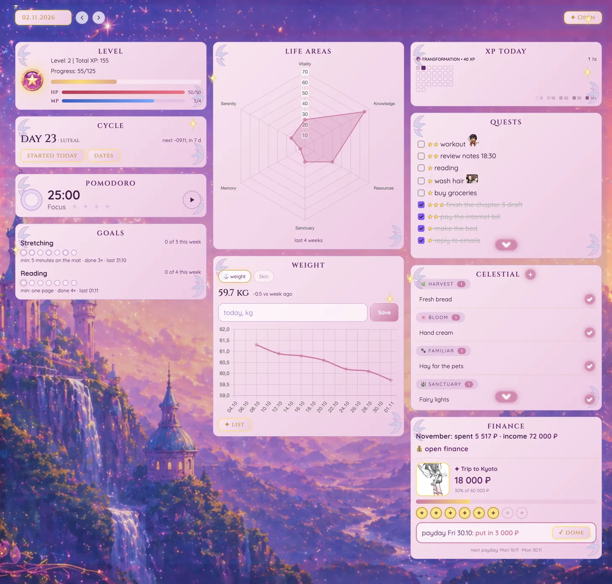

[← Docs](index.md)

# 🖥 Dashboard

The dashboard is a page of the [Winx tab](#the-winx-tab) (below). At the top: the day it shows (‹ › and **today**; no date set means today, and it moves on at midnight), and **✦ Open** for that day's daily note. After a change to the tasks or the data the tab dims with a pink ✦ until the cards have redrawn. Its layout is `plugin/src/components/pages/dashboard/layout.md`: the same callouts and `winx` blocks a note would have.



| Card | What it shows |
|---|---|
| **Level** | Current level, total XP, progress to the next level |
| **Pomodoro** | 25/5 min focus timer, session counter; 🧘 switches to a meditation (10 min by default, its own length and music under ⚙: none, Pad, Bells or Harp, a 30 s loop in `00 System/Assets/winx music` that fades out over the last seconds; a chime at its end, its minutes counted apart); a running session keeps the screen on, so the Mac doesn't sleep |
| **Goals** | Per goal "X of Y this week", Mon–Sun dots, the minimum version |
| **Life Areas** | Radar chart — XP earned per area this month |
| **Cycle** | Cycle day, next start forecast, "started today" button |
| **Weight** | Last 30 days chart, change vs a week ago, a field to log today's weight; the second pill shows a free journal (`00 System/Data/Journals/`, a note each: a level 0–3 a day and its reasons; with more than one, a select under the pills picks it): a click on a level or a reason saves the day |
| **XP Today** | XP earned today, level name, streak heatmap |
| **Quests** | Tasks due today, grouped by life area (a `winx` block: `quests`) |
| **Celestial Market** | Pending shopping items grouped by category |

Any note can show a widget too, with a `winx` block: the widget's name, then `key: value` lines. `card: Title` draws it inside a dashboard card (`meta: scroll` / `scroll tall` for the scrolling ones):

````
```winx
weight
card: Weight
```
````

## The Winx tab

One tab holds all of Winx. The ✨ icon on the left or **Winx: Open** (Cmd+P) opens it, pinned, or reveals it if it is already open. Inside it are the pages **Dashboard**, **Calendar**, **Projects**, **Finance**, **Shop**, **Supplies** and **Food**; the tab remembers the page you were on. Finance, Shop, Supplies and Food are notes (their `winx` blocks) drawn inside the tab.

- **Desktop:** a floating pill at the top: ✦ Dashboard, 🗓 Calendar, ⋯ Other. The labels show on hover, and the pill collapses after a click. **⋯ Other** opens a drawer from the left with every page, one row each; the ↗ on a row opens that page in a new tab, and **⚙ Settings** (XP, gold, areas, XP Today, the level cost) is the last row.
- **Phone:** a bottom bar of three (the same three) and a sheet for the rest.
- **A page in a new tab:** Cmd-click a page, or its ↗, opens it in a new Winx tab that is not pinned.
- **Back / Forward** walk the pages you visited in the tab, not the notes.
- **Links:** a link to an ordinary note opens it in a new tab; a link to the note of a Winx page (say `Shop`) switches the page instead.
- **Old tabs:** a saved dashboard, calendar or projects tab from before turns into a Winx tab on that page when it is shown.

**Food** (the food journal): a week, a row a day: what was eaten with its marks, the marks counted, each free journal's level after its lag, 💊 a course on that day, a note; ＋ a fuzzy search of the foods or a new one, ✎ a food, ⚙ the marks.

## 🎮 XP & Levels

Completing a task awards XP and gold by its difficulty (the `difficulty` of its record in `tasks.json`). The defaults below; **⚙ Settings** (the last row of the Winx tab's drawer, or **Winx: Settings**) changes them, the areas, XP Today's thresholds (SPARK 10 / GLOW 20 / AURA 30) and the level cost, saved in `00 System/Data/config.json`:

| Difficulty | XP | Gold |
|---|---|---|
| ⭐ `easy` | 5 | 2 |
| ⭐⭐ `medium` | 10 | 5 |
| ⭐⭐⭐ `hard` | 20 | 10 |
| ⭐⭐⭐⭐ `epic` | 50 | 25 |
| No XP `none` | 0 (fixed) | 0 (configurable) |

Choose **No XP (0 XP)** in a task’s Difficulty field for activities that should not earn experience. These tasks never change HP, whether completed or overdue. Gold is configured separately in the **No XP** row of Settings; its default is zero. This applies to the selected task, not its whole life area.

Level `n` costs `100 + (n-1) × 25` XP (base and step in ⚙ Settings).

## Life areas

The default areas; in ⚙ Settings each has a key (what a task's record says), an icon, a name, a radar name and a colour (the calendar's stripe and balance bar). A changed key with ☑ **Apply** moves its tasks to the new key; an area that still has tasks can't be removed.

| Area | Key | Radar name |
|---|---|---|
| 🌺 Body | `body` | Vitality |
| 🔮 Mind | `mind` | Knowledge |
| 💎 Wealth | `wealth` | Resources |
| 🏰 Base | `base` | Sanctuary |
| 🌠 Occasions | `occasions` | Memory |
| 🌙 Rest | `rest` | Serenity |

A task whose area isn't in the list (an old one) shows no icon or colour and counts for no area.

---

## 🛍 Shop

Gold from tasks buys real-world rewards listed in `00 System/Data/Shop.md` (`- name:: Cozy Coffee cost:: 20`). The Shop page shows the balance; a click on an affordable item logs it to `Purchases.md` (or use **Winx: Buy reward**).

## 🌌 Celestial Market

A shopping list card. `00 System/Data/Market/items.json` holds each item's name and category by ID (the first item added starts it), and `00 System/Data/Celestial Market.md` is its log, in the Tasks plugin's Dataview format (`- [ ] m12`, then `- [x] m12 [completion:: 2026-11-11]`; lines bought earlier keep their `✅ 2026-11-11`). Ticking an item clears it from the card. Renaming its catalog record keeps its purchase history and Supplies estimates attached to the same ID. The add/search window also finds catalog items never bought yet; adding an already-open ID leaves one open copy.

A log of old name/tag lines (`- [ ] green tea #food`) needs **Winx: Migrate market** once; until then such a line shows its words under ✦ Other. The migration is explicit, preserves the log's lines/statuses/dates and keeps `Celestial Market (old).md`. If its final write fails, running it again resumes from the catalog; lines added meanwhile are migrated too, and the backup stays the log as it was at the first run. To restore the pre-migration state, copy the backup over the log and remove `Market/items.json`; keep any later purchases separately before restoring.

Categories: 🌿 Harvest `#food`, 🌸 Bloom `#care`, 🐾 Familiar `#pet`, 🏰 Sanctuary `#home`, ✨ Vitality `#health`; untagged items land in ✦ Other.

## 🎯 Goals

A goal is a recurring task whose record in `tasks.json` has `"goal": "<key>"`, ticked like any task. `00 System/Data/Goals.md` describes each one:

```
- name:: Stretching
  key:: stretch
  days:: tue, thu, sat
  min:: 5 minutes on the mat
  plan:: when I shut the laptop in the evening, I roll out the mat
```

- `key` is the goal's key: a task counts for it when its record says `"goal": "stretch"`. **Winx: Migrate tasks** turns an old `tag:: #goal/stretch` into `key:: stretch`.
- `days` sets the weekly plan; otherwise `perWeek:: N` (`days` wins if both are given). A day counts when a done task of the goal has its `✅` on that day. Weeks start on Monday.
- A missed goal task stays on its day: the calendar's **Missed?** lists it, to tick it for that day or move it to today.

## 📝 Daily Note

Notes (free text) and an XP Log. Made by **✦ Open** on the dashboard for the selected day (its layout: `daily` in `plugin/src/models/kinds.js`).
