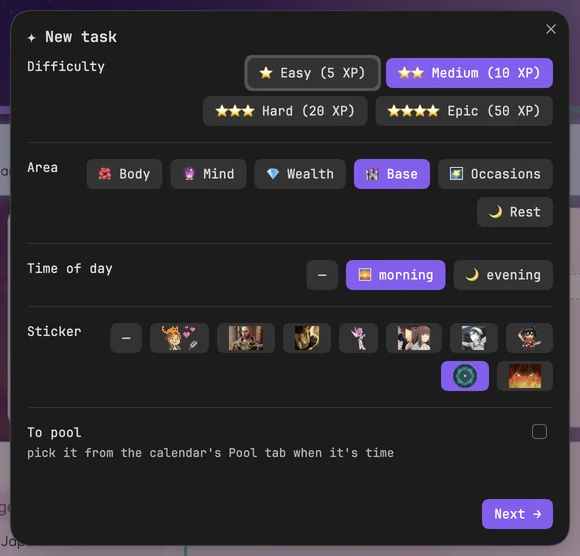
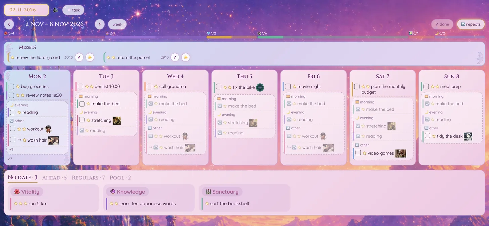
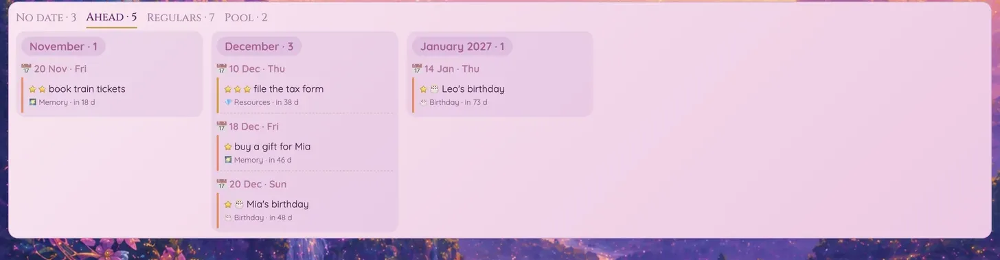

[← Docs](index.md)

# ✅ Tasks and the calendar

## Tasks and commands



Tasks live in `00 System/Data/Tasks/Master.md` in the Tasks plugin's format, tagged with a difficulty and a life area:

```
- [ ] #⭐⭐medium #area/mind #time/evening read a chapter ![[rings.webp|28]] 🔁 every week on Tuesday, Thursday 📅 2026-11-03
```

**Winx: New task** (Cmd+P, or **＋ task** in the calendar):
1. One window: difficulty and area (both needed), time of day, sticker; or tick **To pool** to keep it in `Pool.md` instead
2. Text and dates in the Tasks dialog
3. The task goes to the top of `Master.md` (a pool item to the end of `Pool.md`)

| Command (Cmd+P) | Creates |
|---|---|
| **Winx: New task** | a task in `Tasks/Master.md` |
| **Winx: New watch item** / **New read item** / **New game** | a note in `03 Resources/Collections/Watchlist` / `Readlist` / `Gamelist` |
| **Winx: New recipe** | a note in `03 Resources/Collections/Recipes` |
| **Winx: New work task** | a note in `01 Projects/Work/tasks` (another folder: `"workTasks"` in the plugin's `data.json`), named `<next number>_<title in lower case with underscores>` |
| **Winx: New medication course** | a note in `00 System/Data/Medication` (`"meds"` in `data.json`): a group per medicine (+ adds one): name, dose, when (morning / morning and evening / day / evening / any), the meal (before / after / before sleep / any), its days; a start; the day by its anchors (a time of day and a meal: what to take then) and the codes' legend on cards, and a day per row up to the longest course inside a ```winx meds block that draws the course (today's doses as chips, the grid, a note per day) and ticks a cell round ☐ → ✅ → ❌ (its legend: taken, skipped on purpose, not marked) on a click, writing the table. A notes field (several lines) goes on a Заметки card. **Winx: Edit medication course** (or the ✎ by the course card's title) opens the same window with the course's values (kept in its `meds` property) and rebuilds the note: the marks and the days' notes carry over by date and column, cards written by hand stay. The courses' list: `_index.base` in the folder, linked from the dashboard's Pages card |
| **Winx: Buy reward** | a line in `00 System/Data/Purchases.md` |
| **Winx: New market item** | an item in `00 System/Data/Celestial Market.md` |

**Winx: Menu** (Alt+T) lists every Winx command to pick from. On the desktop Winx also sends today's reminders: a goal's task at the goal's time, a task with `HH:MM` in its text 30 minutes before, and a morning summary.

## 📅 Calendar

A tab of its own: **Winx: Open calendar** (Cmd+P) or the ✨ icon on the left (with the dashboard). The tasks of `00 System/Data/Tasks` on a week or a month. Pin the tab, drag it to a sidebar or a window; it keeps its week, tab and unfolded days across restarts (Obsidian saves them with the layout). Until you pick a date it follows today.



- **Days** show one-off tasks, and a day's 🔁 tasks folded into one pill "🔁 2/5"; a click unfolds them, grouped by time of day (`#time/morning`, `#time/evening`).
- **Drag** a task onto a day: open and due that day, or ✓ done that day. While dragging, a bar of 7 days sticks to the top of the screen.
- **Missed?** lists open tasks whose day has passed: ✓ done that day, or ☀️ move to today.
- **Bottom tabs:** **No date** (open tasks without a date), **Ahead** (dated tasks after this week and the birthdays, a card per month), **Regulars** (🔁 tasks), **Pool** (tasks to pick when it's time, from `Tasks/Pool.md`: drag one onto a day to make a copy).

  
- **On a task:** ⭐ change difficulty, ✏️ edit (the task window, then the Tasks dialog), ⏭ skip a 🔁 task this time, 🗑 delete (click twice). On the phone, swipe right = done, swipe left = skip / take the date off.
- **Stickers:** `![[name.gif|28]]` in a task's text (files in `00 System/Assets/stickers/`); hover to see one big.
